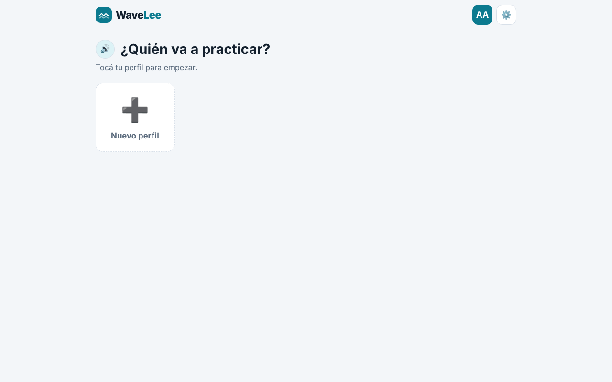

# 📖 WaveLee

> Accessible literacy web app for secondary students who are still learning to read and write — guided by voice, step by step.

    

## Overview
An inclusion project: a single-file web app that takes students from letters to short texts, with every instruction read aloud. No installation, no accounts, no server.

## Key features
- **8 progressive modules**: letters → syllables → building words → reading words → sentences → dictation → short texts with comprehension questions → free writing.
- **Text-to-speech** on every prompt (Web Speech API), adjustable voice and speed.
- **Accessibility**: lowercase / UPPERCASE toggle, Lexend font, font size, light/dark theme, auto-read.
- **Student profiles** with avatars and a **teacher dashboard**: stars per module, accuracy, streaks, words to review and written texts; JSON export/import.

## Tech stack
A single `index.html` with vanilla JavaScript, Web Speech API and `localStorage`.

## Run locally
Open `index.html` in Chrome or Edge (they ship Spanish voices).

📘 Detailed guide (Spanish): [docs/GUIA.md](docs/GUIA.md)

---

## Author

**Guillermo Cuenya** — Senior QA Automation Engineer / SDET · Telecommunications Engineer  
[LinkedIn](https://www.linkedin.com/in/guillermoadriancuenya/) · [GitHub](https://github.com/guillermocuenya) · [Portfolio](https://guillermocuenya.github.io)
